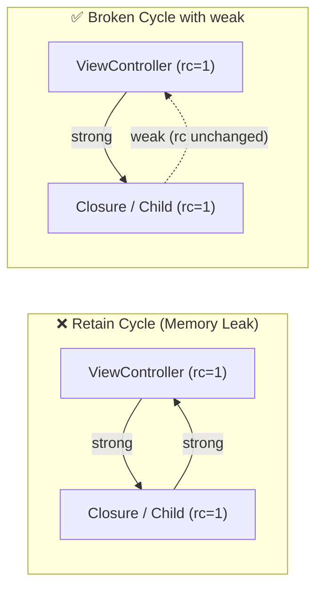

# Week 1: Swift Fundamentals & Memory Model (Through an Android Developer's Lens)

> **Goal**: Understand how Swift looks deceptively similar to Kotlin on the surface, yet operates on a fundamentally different type system and memory management model underneath.

---

## 1. Value Types (`struct`) vs. Reference Types (`class`)

### The Android (Kotlin/JVM) Mental Model
In Kotlin on the JVM, almost everything (including a `data class`) is a **reference type** allocated on the heap (barring `@JvmInline value class` or primitives).
- When you pass a `data class User(var name: String)` to a function, you pass a **reference** to the same heap object.
- Immutability in Kotlin is enforced via `val` properties and `.copy()`, not by copying memory on assignment.

### The iOS (Swift) Mental Model
In Swift, **`struct` (a true value type) is the default** for models, collections (`Array`, `Dictionary`, `String`), and even `SwiftUI` views.
- Assigning a `struct` to a new variable or passing it into a function **copies the value** semantically.
- Mutating the copy **never** affects the original instance.
- **Copy-on-Write (CoW)**: Swift collections (`Array`, `Dictionary`, `String`) don't eagerly duplicate huge buffers on every assignment. They share the underlying buffer until one of the copies is mutated, giving you $O(1)$ assignment with full value isolation.

| Feature | Swift `struct` (Value Type) | Swift `class` (Reference Type) | Kotlin `data class` |
| :--- | :--- | :--- | :--- |
| **Allocation** | Stack / Inline (or CoW buffer) | Heap | Heap |
| **Assignment (`b = a`)** | Copies the value (independent) | Copies the pointer (shared instance) | Copies the reference (shared instance) |
| **Mutability keyword** | `let` = deeply immutable struct! | `let` = constant pointer, mutable properties | `val` = constant reference, `var` props can mutate |
| **Inheritance** | ❌ No class inheritance (Conforms to `protocol`s) | ✅ Supports single inheritance | ❌ `data class` cannot be `open` |
| **Thread Safety** | ✅ Inherently safe against shared-state races | ⚠️ Requires `Actor`, locks, or `@MainActor` | ⚠️ Requires immutable `val`s or synchronization |

### Crucial Gotcha: `let` vs `val`
- **Kotlin**: `val user = User(name = "Alex")` only prevents reassigning `user`. If `name` is a `var`, `user.name = "Sam"` still compiles!
- **Swift**: If `User` is a `struct`, `let user = User(name: "Alex")` makes the **entire struct and all its `var` properties immutable**. Even mutating methods (`mutating func`) cannot be called on a `let` struct.

---

## 2. Memory Management: ARC vs. Tracing Garbage Collection

### Android (ART / JVM Garbage Collector)
- Uses a concurrent, generational tracing garbage collector.
- Objects that reference each other in a cycle (`Parent <-> Child`) are still collected as long as neither is reachable from a GC root.
- **Trade-off**: Non-deterministic deallocation timing and potential GC pauses / higher baseline memory footprint.

### iOS (Automatic Reference Counting - ARC)
- Swift tracks the retain count of every **`class` instance** at compile time by inserting `retain` and `release` calls.
- The moment a class instance's reference count drops to `0`, `deinit` is called **immediately and deterministically** on the current thread.
- **The Retain Cycle Trap**: If Object A holds a strong reference to Object B, and Object B holds a strong reference to Object A (`A <-> B`), their reference counts never reach `0`, causing a **permanent memory leak**.



### Breaking Cycles in Swift
1. **`weak var`**: Does not increment the reference count. Must always be an **Optional** (`var delegate: MyDelegate?`) because ARC automatically sets it to `nil` when the target deallocates.
2. **`unowned let/var`**: Does not increment the reference count, and is non-optional—but crashes if accessed after the referenced object is deallocated. **Rule of thumb**: Prefer `weak` (`[weak self]`) in closures unless lifetimes are strictly guaranteed.

---

## 3. Optionals & Unwrapping (`?`, `if let`, `guard let`)

Both Kotlin and Swift treat nullability as part of the type system (`String?` vs `String`), where Swift's `String?` is actually syntactic sugar for an enum: `Optional<String>` with cases `.none` (`nil`) and `.some(Wrapped)`.

| Operation | Kotlin | Swift |
| :--- | :--- | :--- |
| **Safe call** | `user?.profile?.avatarUrl` | `user?.profile?.avatarUrl` |
| **Default value (Elvis / Nil-Coalescing)** | `name ?: "Guest"` | `name ?? "Guest"` |
| **Force unwrap (Crash on null)** | `name!!` | `name!` |
| **Smart cast / Scoped unwrap** | `if (name != null) { print(name.length) }` | `if let name { print(name.count) }` |
| **Early exit unwrap** | `val name = input ?: return` | `guard let name = input else { return }` |

### Why `guard let` is Idiomatic Swift
In Kotlin, we frequently write `val user = repo.getUser() ?: return`.
In Swift, `guard` is a dedicated control-flow statement whose compiler contract **forces** the `else` block to exit the current scope (`return`, `throw`, `break`, or `continue`), keeping the unwrapped variable in scope for the rest of the function (the "Golden Path").

---

## 4. Functions, Named Arguments & Closures

- **External vs. Internal Parameter Names**:
  Swift functions read like English sentences at the call site:
  ```swift
  // 'from' and 'to' are external labels; 'source' and 'destination' are internal names
  func transfer(amount: Double, from source: Account, to destination: Account)
  // Call site:
  transfer(amount: 100.0, from: checking, to: savings)
  ```
  Use `_` to omit an external label (`func log(_ message: String)`).
- **Closures vs. Kotlin Lambdas**:
  - Kotlin puts the lambda brace first and uses `->`: `{ item -> item.id }` (or implicit `it`).
  - Swift puts the signature *inside* the braces and uses the `in` keyword: `{ item in item.id }` (or shorthand positional arguments `$0`, `$1`).
  - Both support **trailing closure syntax** when the closure is the final parameter.
- **Value Capture in Closures**:
  In Swift, closures are reference types and capture variables strongly by default. To avoid leaking `self` in an escaping closure (like a network callback), use a **capture list**:
  ```swift
  service.fetchData { [weak self] result in
      guard let self else { return }
      self.render(result)
  }
  ```

---

## 5. Enums & Pattern Matching (Kotlin `sealed interface` on Steroids)

In Kotlin, an `enum class` only holds static constants; when you need per-case payloads (like `Loading`, `Success(data)`, `Error(cause)`), you switch to a `sealed class` or `sealed interface`.

In Swift, **`enum` directly supports associated values** (Algebraic Sum Types) while remaining a lightweight **value type**:
```swift
enum UiState<T> {
    case idle
    case loading(progress: Double)
    case success(data: T)
    case failure(message: String, retryable: Bool)
}
```
And `switch` in Swift is exhaustive by default (no `break` required, no accidental fallthrough).
